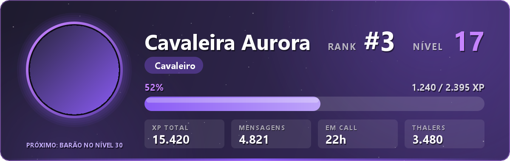
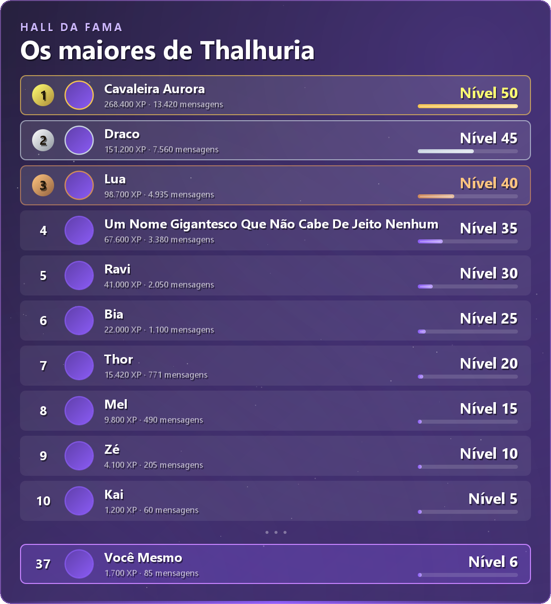

# 📖 Comandos do Bot Thalhuria

Todos os comandos são **slash** (digite `/` no Discord). Os comandos de staff só aparecem no menu para quem tem a permissão indicada; as ações sensíveis conferem a permissão de novo na hora de executar.

**Sumário:** [👥 Membros](#-para-todos-os-membros) · [🛡️ Moderação](#️-moderação) · [📅 Eventos](#-eventos) · [👑 Administração](#-administração) · [🖱️ Botões e painéis](#️-botões-menus-e-painéis) · [⚡ Automáticos](#-o-que-acontece-sozinho)

---

## 👥 Para todos os membros

### ⚔️ Níveis

| Comando | O que faz |
| :--- | :--- |
| `/rank` | Seu **cartão de rank** em imagem: nível, posição, barra de XP, XP total, mensagens, tempo em call, Thalers, título atual e próxima recompensa. |
| `/rank usuario:@Fulano` | O cartão de outro membro. |
| `/top` | **Placar em imagem** com o top 10 por nível. Se você não está no top 10, aparece sua posição no rodapé. |
| `/top ranking:<opção>` | Escolhe o placar: ⚔️ **Nível** · 🪙 **Riqueza** · 🔊 **Tempo em call** · 💬 **Mensagens** · 🎟️ **Convites**. |




> **Como ganhar XP:** 15–25 XP por mensagem (no máximo uma a cada 60s) e 10 XP por minuto em call com pelo menos mais uma pessoa. O canal 🤖・comandos não dá XP.

### 🪙 Economia

| Comando | O que faz |
| :--- | :--- |
| `/daily` | Resgata a recompensa diária (**150 Thalers** + 25 por dia de sequência, até 7 dias). Libera a cada 20h; a sequência continua se você voltar em até 48h. |
| `/saldo` · `/saldo usuario:@Fulano` | Quantos Thalers você (ou outra pessoa) tem. |
| `/pagar usuario:@Fulano valor:500` | Envia Thalers para alguém. |
| `/loja` | Abre o **Mercado Real** (só você vê) com um menu para comprar cores de nome e títulos. Cores são exclusivas: comprar uma nova troca a anterior. |

### 🎟️ Convites

| Comando | O que faz |
| :--- | :--- |
| `/convites ver` | Seu registro de recrutamento: válidos, aguardando verificação, saíram, contas novas e quanto falta para o próximo título. |
| `/convites ver usuario:@Fulano` | O registro de outra pessoa. |
| `/convites ranking` | Os 10 maiores recrutadores. |

> Cada convidado que **se verifica** rende **250 Thalers** a quem convidou. Títulos: 📯 Recrutador (3) · 🏹 Batedor do Reino (10) · 🦅 Mestre dos Recrutas (25). Contas com menos de 7 dias e quem sai e volta não contam de novo.

### 📅 Eventos

| Comando | O que faz |
| :--- | :--- |
| `/evento listar` | Próximos eventos do servidor, com horário e link. |

---

## 🛡️ Moderação

Visível para quem tem **Castigar membros**. Cada ação exige também a permissão específica do Discord (ex.: banir exige **Banir membros**). Todas as respostas são privadas e tudo vai para 🛡️・logs-moderação.

| Comando | Permissão | O que faz |
| :--- | :--- | :--- |
| `/mod advertir usuario motivo` | Castigar membros | Registra uma advertência e avisa o membro por DM. **Punição automática** ao acumular: 3 = castigo de 1h · 5 = castigo de 24h · 7 = banimento (advertências valem 30 dias). |
| `/mod castigo usuario minutos motivo` | Castigar membros | Silencia o membro (timeout nativo) por até 28 dias. |
| `/mod remover-castigo usuario` | Castigar membros | Encerra o castigo. |
| `/mod expulsar usuario motivo` | Expulsar membros | Expulsa do servidor (avisa por DM antes). |
| `/mod banir usuario motivo [apagar_dias]` | Banir membros | Bane; opcionalmente apaga as mensagens dos últimos 0–7 dias. Aceita quem já saiu do servidor. |
| `/mod limpar quantidade [usuario]` | Gerenciar mensagens | Apaga até 100 mensagens recentes do canal (opcionalmente só de um membro). Mensagens com mais de 14 dias não podem ser apagadas em massa. |
| `/mod historico usuario` | Castigar membros | Histórico completo: advertências, castigos, expulsões e banimentos, com número, data, moderador e motivo. |
| `/mod perdoar id` | Castigar membros | Retira uma infração do histórico ativo (o número aparece no `/mod historico`). |

> O bot não pune o dono do servidor, cargos acima do dele, nem cargos iguais ou acima de quem executou.

---

## 📅 Eventos

| Comando | Permissão | O que faz |
| :--- | :--- | :--- |
| `/evento criar nome inicio [duracao] [local] [descricao]` | Gerenciar eventos | Cria o **evento nativo** do Discord, anuncia em 🎉・eventos marcando 🎉 Eventos e envia um lembrete 15 min antes. |

**Formato da data:** `25/12/2026 20:00` ou `25/12 20:00` (ano atual), no fuso de Brasília.

```
/evento criar nome:Noite de Valorant inicio:25/12 20:00 duracao:120 local:Arena 01 descricao:Torneio 5v5 valendo cargo!
```

---

## 👑 Administração

| Comando | Quem | O que faz |
| :--- | :--- | :--- |
| `/boas-vindas usuario [dm]` | **Só o dono** | Reenvia as boas-vindas (cartão + mensagem) **marcando o membro**. `dm:true` reenvia também a mensagem privada. |
| `/server-status` | Admin | Diagnóstico: cargos/categorias/canais/painéis existentes × template, cargos acima do bot, recursos ativos e problemas do template. |
| `/sync-server` | Admin | Aplica as mudanças do `server-template.json` **sem apagar nada**: cria o que falta, renomeia, move, ajusta permissões, painéis e AutoMod. |
| `/sync-server simular:true` | Admin | Mostra o que o sync faria, **sem alterar nada**. |
| `/setup-server` | Admin | ⚠️ **Apaga todos os canais e cargos** do servidor e recria tudo pelo template (confirmação por botão). |
| `/rebuild-server modo:bot` | Admin | Apaga só o que o bot criou e recria. |
| `/rebuild-server modo:tudo` | Admin | Igual ao `/setup-server`, mas pede para **digitar o nome do servidor** para confirmar. |
| `/reset-server` | Admin | Apaga tudo o que o bot gerencia **sem recriar** (confirmação por botão). |
| `/backup` | Admin | Exporta o servidor atual como template JSON (anexo + cópia em `backups/`). Para restaurar: copie para `templates/<ID>.json` e rode `/setup-server`. |
| `/membro configurar usuario [criar_sala]` | Admin | Dá o cargo ✨ Cidadão e (opcional) cria uma sala privada com a administração. |

> Nos comandos que apagam canais (`/setup-server`, `/rebuild-server`, `/reset-server`), o resultado é enviado no novo canal de logs e na sua DM, porque o canal onde você digitou provavelmente vai sumir.

---

## 🖱️ Botões, menus e painéis

Não são comandos: são interações nos painéis que o bot publica.

| Onde | Interação | O que faz |
| :--- | :--- | :--- |
| ✅・verificação | **🗝️ Entrar no reino** | Troca 🌱 Viajante por ✨ Cidadão e libera o servidor. Também libera a recompensa de quem te convidou. |
| 🎭・cargos | Menu **Selecione seus cargos** | Marca/desmarca interesses e notificações (🔔 🎉 🎮 🎨 🎵 🎬). |
| 🎫・abrir-ticket | **🧭 Suporte · 🚨 Denúncia · 🤝 Parceria** | Abre um canal privado com a equipe certa. |
| Dentro do ticket | **🔒 Fechar ticket** | Fecha (dono do ticket ou staff); a transcrição HTML vai para os logs e para a DM de quem abriu. |
| `/loja` | Menu de itens | Compra o item escolhido. |
| Chat da sua sala temporária | **🔒 Trancar · 👁️ Ocultar · ✏️ Renomear · 👥 Limite · 👑 Transferir** | Controla a sua sala (só o dono). |

### 🔊 Salas temporárias
Entre em **➕・Criar Sala**: o bot cria **🔊・Salão de <seu nome>** e te move para lá. A sala é sua (renomear, limitar, trancar, ocultar, transferir) e some quando todos saem.

### 💡 Sugestões
Toda mensagem em 💡・sugestões ganha ✅/❌ para votação e um tópico de discussão.

---

## ⚡ O que acontece sozinho

| Quando | O bot... |
| :--- | :--- |
| Alguém entra | Dá 🌱 Viajante, descobre **por qual convite** entrou, posta o **cartão de boas-vindas** marcando a pessoa e envia uma **DM com guia**. Bots recebem ⚙️ Autômato. |
| Alguém se verifica | Dá ✨ Cidadão e paga a recompensa de convite. |
| Alguém conversa ou fica em call | Soma XP e Thalers; ao subir de nível, anuncia em 🏆・conquistas e entrega títulos (🗡️ 5 · ⚔️ 15 · 🏰 30 · 🐉 50). |
| Alguém quebra uma regra do AutoMod | O próprio Discord bloqueia (palavras/golpes, convites, menções em massa, spam) e alerta a staff. |
| Mensagem apagada/editada, ban, castigo, entrada/saída de call | Registra em 🛡️・logs-moderação. |
| A cada 10 minutos | Atualiza os contadores 👥 Habitantes · 🟢 Online · 🚀 Boosts. |
| A cada `/sync-server` ou setup | Dá 👑 Soberano ao dono, recria as regras de AutoMod e atualiza todos os painéis. |
